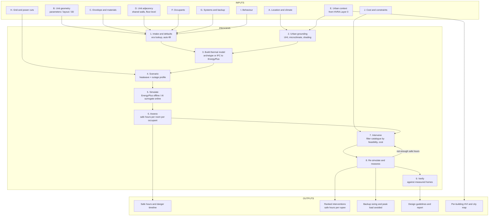

# OASIS: complete tool specification (inputs → process → outputs)

**OASIS: Overheating Assessment System for Intervention Strategies.**
MAAI thesis, IAAC Barcelona, 2026/27 (final: June 2027). Author: Nithik Vairamuthu.

This file lists **every input the full thesis tool needs**, where each one comes from, what it drives, and how inputs flow through the process to the outputs. The MVP (see `OASIS_MVP_START.md`) uses only the inputs marked **MVP**.

---

## 1. The tool in one paragraph

A user describes a **residential unit** (as parameters, a 2D layout or a 3D model) and its **occupants**. OASIS places it in its **urban context** (reusing the HVRA 1.0 urban analysis), applies a **heatwave** and a **realistic power-cut profile**, and predicts **how many safe hours each room gives each occupant**. It then tests **interventions** (design, systems, backup power), re-simulates, keeps only those that really add safe hours, and ranks them by **safe hours gained per rupee**. For new designs it acts as a design-stage check; for existing homes it gives no-cost / low-cost advice.

### Two layers (from HVRA 1.0)
| Layer | Scale | Tool | Question |
|---|---|---|---|
| **Layer 0** | Neighbourhood / city | **HVRA 1.0** (helios0007/HVRA, urban backend) | *Where* is heat risk highest, and is urban-scale action enough? → per-building **HVI** |
| **Layer 1** | Building / unit / room | **OASIS** (this thesis) | *How long* does this unit stay safe in a heatwave with a power cut, and *what design change* fixes it? → **safe hours** |

Layer 0 hands Layer 1 the urban context automatically (UHI delta, microclimate, neighbour shading, HVI score), the same way HVRA's `[urban-grounding]` hook passes `urban_uhi_delta` to the building pipeline.

---

## 2. Flowchart



ASCII version (for plain-text viewers):
```
INPUTS                               PROCESS                                OUTPUTS
A Location + climate ──┐
E Urban context (L0) ──┴─► 2 Urban grounding ─┐
B Geometry ────────────┐                      ▼
C Envelope ────────────┤                  3 Build thermal model
D Adjacency ───────────┼─► 1 Intake ─────────►│
F Occupants ───────────┤   + defaults         ▼
G Systems + backup ────┤                  4 Scenario ◄── H Grid + power cuts
I Behaviour ───────────┘                      ▼
                                          5 Simulate (EnergyPlus / AI)
                                              ▼
                                          6 Assess safe hours ─────────────► Safe hours + timeline
                                              ▼
J Cost + constraints ────────────────────► 7 Intervene ◄──┐
                                              ▼            │ not enough
                                          8 Re-simulate ───┘ ──────────────► Ranked interventions
                                              ▼                             Backup sizing, peak load
                                          9 Verify ────────────────────────► Guidelines + report
E Urban context ───────────────────────────────────────────────────────────► HVI map (Layer 0)
```

---

## 3. Input list

**Source** key: **User** = typed or chosen by the user · **File** = uploaded · **Auto** = fetched or derived by the tool · **Default** = lookup table when the user doesn't know.
**Phase** key: **MVP** = needed now · **v1** = by the February sweep · **v2** = full thesis tool (April–June).

### A. Location and climate
| # | Input | Source | Drives | Phase |
|---|---|---|---|---|
| A1 | Location (lat/lon, map picker) | User | Sun position, weather file, urban context lookup | MVP |
| A2 | City / climate zone (NBC: warm-humid, hot-dry, composite…) | Auto from A1 | Default materials, ENS requirements, thresholds | v1 |
| A3 | Weather file (EPW: ISHRAE / TMYx) | Auto / File | Hourly outdoor temperature, humidity, solar, wind | MVP |
| A4 | Heatwave definition (which week, or IMD heatwave criteria) | Default | Simulation period | MVP |
| A5 | Future climate scenario (current / 2050 / 2080, e.g. morphed EPW) | User / Default | Design for the climate the building will face | v2 |

### B. Unit geometry
**Input mode** (user picks one, in order of detail): **parameters** → **2D layout** (plan image or DXF) → **3D model** (IFC / Rhino) → *phone scan (later)*. Every mode must produce the same set of derived values.

| # | Input | Source | Drives | Phase |
|---|---|---|---|---|
| B1 | Input mode (parameters / layout / 3D) | User | Which parser runs | v1 |
| B2 | Floor area, number of rooms, room types (bedroom, living, kitchen, toilet) | User / derived from layout or IFC | Zones, internal gains per room | MVP (one room) |
| B3 | Ceiling height | User / IFC / Default 3.0 m | Air volume, stratification | MVP |
| B4 | Orientation of the unit / each façade | User / IFC | Solar gain per façade | MVP |
| B5 | Windows: position, size, façade, sill height | Layout / IFC | Solar gain, ventilation, WWR | MVP (as WWR) |
| B6 | Openable window area and type (sliding = 50 %, casement = 90 %) | User / Default | Natural ventilation; ENS check (≥ 16.66 % of floor area, warm-humid) | v1 |
| B7 | Cross-ventilation possible (openings on two façades)? | Derived from B5 | Air change rate | v1 |
| B8 | Balconies, chajjas (overhangs), fins, jaalis | Layout / IFC / User | Self-shading | MVP (overhang depth) |
| B9 | Door positions (internal) | Layout / IFC | Air flow between rooms | v2 |

### C. Envelope and materials
| # | Input | Source | Drives | Phase |
|---|---|---|---|---|
| C1 | **Construction year / era** | User | Default U-values, glazing, construction type if C2–C6 unknown | v1 |
| C2 | Wall build-up (brick 230 / brick 115 / AAC / fly-ash / concrete block / RCC shear wall + plaster) | User / IFC / Default by era | Heat flow, thermal mass | MVP |
| C3 | Roof type (RCC slab / RCC + weathering course / tin / asbestos / tile) | User | Roof heat gain (largest in top floors) | MVP |
| C4 | Roof surface finish and colour (grey / white coat / tiles / terrace garden) | User | Solar absorptance | MVP |
| C5 | Roof and wall insulation (none / type, thickness) | User | U-value | MVP (as variant) |
| C6 | Glazing type (single clear / tinted / double), frame | User / Default | U-value, SHGC | v1 |
| C7 | External shading devices (louvres, blinds, shutters) | User | Solar gain | v1 |
| C8 | Floor / slab construction (ground contact or suspended) | Derived from D3 | Ground coupling | v1 |
| C9 | Airtightness / infiltration (leaky / average / tight) | Default by era | Infiltration air change rate | v1 |
| C10 | Special materials (PCM, cool paint, radiant barrier) | User / Intervention | Intervention testing | v1 |

### D. Unit adjacency (the unit inside its building)
| # | Input | Source | Drives | Phase |
|---|---|---|---|---|
| D1 | Building: number of floors, typology (row house, apartment block, independent house) | User / Layer 0 | Exposure, defaults | v1 |
| D2 | **Floor level of the unit** (ground / middle / top) | User / IFC | Roof exposure (top floor = worst), ground coupling | MVP |
| D3 | Unit above / below: occupied flat, terrace, parking, ground | User | Boundary condition of floor and ceiling | MVP (top floor, flat below) |
| D4 | **Shared walls**: which façades, neighbour occupied? cooled? | User / Layout | Adiabatic vs exposed walls | v1 |
| D5 | Corner or middle unit | User / Layout | Number of exposed façades | v1 |
| D6 | Adjacent semi-open spaces: corridor, stairwell, shaft, courtyard, balcony | Layout / User | Ventilation paths, buffer zones | v2 |

### E. Urban context (Layer 0, reused from HVRA 1.0)
| # | Input | Source (HVRA 1.0 → India equivalent) | Drives | Phase |
|---|---|---|---|---|
| E1 | Neighbouring buildings: footprints and heights | Infrared SDK / OSM → **Google Open Buildings 2.5D** for India | Façade shadow per hour (HVRA `shadow.py` method) | v1 |
| E2 | Street canyon H/W, sky view factor | Infrared geometry + OSM streets | Solar access, night-time cooling to the sky | v1 |
| E3 | Microclimate: street-level UTCI / air temperature heat map | Infrared SDK UTCI simulation | Local weather correction | v2 |
| E4 | Land surface temperature (LST) and **UHI delta** | Landsat 8/9 (global) | `T_outdoor = T_epw + UHI_delta` (HVRA `[urban-grounding]`) | v1 |
| E5 | Vegetation (NDVI, distance to green) | Sentinel-2 (global), OSM | HVI factor; shading by trees | v1 |
| E6 | Ground surface materials / albedo (asphalt, concrete, soil, grass) | OSM tags / satellite classification | Reflected heat on façades, local air temperature | v2 |
| E7 | Wind obstruction (local wind speed reduction) | Infrared wind analysis / canyon factor | Natural ventilation rate | v2 |
| E8 | **Per-building HVI** (0–10) and its 12 factors | HVRA 1.0 output | Prioritisation; occupant vulnerability defaults | v1 |
| E9 | Census / social data (65+, income, no-cooling share) | Idescat (Barcelona) → **Census of India ward data, NFHS** | Default occupant profile if user gives none | v2 |

> **India gap:** HVRA 1.0's cadastre (Catastro) and census (Idescat, Renda) loaders are Barcelona-only. For Chennai: construction year from user input or Google Open Buildings temporal data, social data from Census of India (ward level, 2011, dated) or Chennai Corporation sources. Satellite and OSM loaders already work globally.

### F. Occupants
| # | Input | Source | Drives | Phase |
|---|---|---|---|---|
| F1 | Number of occupants | User | Internal heat gains, CO₂ | MVP |
| F2 | **Age of each occupant** (or: any under 5, any 65+, oldest age) | User | Which safe-hour threshold applies (Chen: 850 °C·h elderly vs 1,174 young) | v1 |
| F3 | **Occupancy schedule**: who is home when, especially **evening and night** | User / Default | Heat gains; *when* exposure counts | v1 |
| F4 | Sleeping room (which room, how many people) | User / Layout | Night-time safe hours per room | v1 |
| F5 | Mobility limitations (can they move to a cooler room / outside?) | User (optional) | Vulnerability multiplier | v2 |
| F6 | Health conditions that raise heat risk (optional, with consent) | User (optional) | Stricter threshold | v2 |
| F7 | Income category / tenure (owner or tenant) | User (optional) | Which interventions are realistic | v2 |
| F8 | Outdoor workers in the household (already heat-loaded on return) | User (optional) | Stricter evening threshold | v2 |

### G. Systems, appliances and backup power
| # | Input | Source | Drives | Phase |
|---|---|---|---|---|
| G1 | **Ceiling fans**: number, per room, speed / air speed | User / Default | Cooling effect on occupants (ASHRAE 55 via pythermalcomfort) | MVP (as fan credit) |
| G2 | **AC**: yes / no, room, type (split / window / inverter), setpoint, hours used | User | Cooled or free-running; grid load | v1 |
| G3 | **Evaporative (desert) cooler**: yes / no | User | Cooling + **adds humidity** (dangerous in humid heat) | v2 |
| G4 | **Power backup**: inverter battery capacity (Wh), what it powers (fans, lights) | User | Which loads survive the cut, for how long | v1 |
| G5 | Rooftop solar PV (kW), battery | User | Daytime/evening backup | v2 |
| G6 | Generator (diesel) | User | Backup (but heat, noise, pollution) | v2 |
| G7 | **Kitchen location and cooking fuel** (LPG / induction / wood), cooking times | User / Layout | Large evening heat gain, often at 7–9 PM | v1 |
| G8 | Other appliances (fridge, TV, lights) | Default | Internal gains | v1 |

### H. Grid and power cuts
| # | Input | Source | Drives | Phase |
|---|---|---|---|---|
| H1 | Electricity distributor (DISCOM) / feeder area | User / Auto from A1 | Which outage statistics apply | v2 |
| H2 | **Outage profile**: frequency, start time, duration, nights per week | Default (Indian outage reports, ESMI monitoring data) / User | Power-cut schedule in the simulation (An 2026 method) | MVP (fixed 8–9 PM) |
| H3 | Worst-case scenario (longest cut during heatwave) | Default | Stress test | v1 |
| H4 | Tariff and time-of-day peak hours | Default (TNPDCL / state tariff) | Peak load avoided, running cost | v2 |

### I. Behaviour and operation
| # | Input | Source | Drives | Phase |
|---|---|---|---|---|
| I1 | **Window opening at night** (often closed for **security, mosquitoes, noise, privacy**) | User / Default | Night ventilation actually possible? | v1 |
| I2 | Curtains / blinds used in daytime | User | Solar gain | v1 |
| I3 | Coping practices: sleeping on terrace, wetting roof or floor, moving to another room | User (optional) | Adaptive capacity, alternative safe space | v2 |

### J. Cost, constraints and mode
| # | Input | Source | Drives | Phase |
|---|---|---|---|---|
| J1 | **Mode: new design or existing home** | User | Full catalogue (new) vs no-cost / low-cost only (existing) | v1 |
| J2 | Budget range | User (optional) | Filters interventions | v2 |
| J3 | Local unit costs (₹/m², ₹/unit) | Default (**CPWD Delhi Schedule of Rates** / state rates) | Safe hours per rupee | v1 |
| J4 | Regulations to check (ENS 2024, NBC 2016) | Default | Compliance flags (RETV, roof U, openable area) | v1 |
| J5 | Constraints: rented (no structural change), shared roof, society rules | User | Filters interventions | v2 |

### K. Configuration (not user inputs, but must be set)
| # | Setting | Value / source | Phase |
|---|---|---|---|
| K1 | Safe-hour metric and thresholds | MVP: heat index < 41 °C · Later: Chen et al. 2024 heat-index hours by age group | MVP → v1 |
| K2 | Fan cooling effect | MVP: 2 °C credit · Later: ASHRAE 55 cooling effect (pythermalcomfort) | MVP → v1 |
| K3 | Intervention catalogue | 10–15 measures (roof, walls, openings, shading, ventilation, backup, PCM) with cost and feasibility tags | v1 |
| K4 | Validation datasets | Tasgaonkar et al. 2022 (South Asia loggers), Chennai SRIHER 2026 | v1 |
| K5 | Default lookup tables by era and climate zone | U-values, SHGC, infiltration (adapt HVRA building-level era tables to Indian construction) | v1 |

---

## 4. Inputs you hadn't listed (added above)
1. **Occupancy schedule and sleeping room (F3, F4):** danger at 8–9 PM only matters if people are home and in that room. The night is the core of OASIS.
2. **Window opening at night (I1):** Indian homes often keep windows shut at night for security and mosquitoes. That cancels night ventilation, one of the main passive measures.
3. **Kitchen and cooking (G7):** cooking adds heat exactly in the 7–9 PM window, in small flats with no separate kitchen.
4. **Fan details (G1)** and **evaporative coolers (G3):** coolers add humidity, which raises heat index in Chennai.
5. **Ceiling height (B3)** and **openable window area / type (B6):** both change ventilation and are ENS checks.
6. **Corner vs middle unit (D5)** and **what's above and below (D3):** these set which surfaces are exposed.
7. **Sky view factor and ground albedo (E2, E6):** they affect night cooling and reflected heat.
8. **Future climate (A5):** new buildings will face 2050 heatwaves, not today's.
9. **Mode: new vs existing (J1)** and **cost data (J3):** needed for the "safe hours per rupee" ranking and the existing-home advice.
10. **India data sources for Layer 0 (E1, E9):** HVRA 1.0's cadastre and census loaders are Barcelona-specific.
11. **Configuration (K):** thresholds, fan model, catalogue and validation data must be defined, even though users never type them.

---

## 5. Process (what happens to the inputs)
| Step | What it does | Key code / method |
|---|---|---|
| 1. Intake and defaults | Validates inputs; fills missing ones from era and climate-zone tables; parses layout / IFC into rooms, windows, orientations | `ifcopenshell` (as in HVRA building-level `ifc_parser.py`); plan parser (v2) |
| 2. Urban grounding | Gets UHI delta, microclimate and neighbour shading from Layer 0; adjusts the weather file | HVRA `[urban-grounding]`, `shadow.py` (pvlib + shapely), Landsat UHI |
| 3. Build thermal model | Turns the unit into an EnergyPlus model (archetype from parameters, or geometry from IFC) | Python + `eppy` → `.idf` |
| 4. Scenario | Sets heatwave period, outage profile, occupancy, fan/AC/backup schedules | EPW selection; An 2026-style outage profiles |
| 5. Simulate | **Offline:** EnergyPlus (training data, checks). **Online:** AI surrogate predicts in seconds | EnergyPlus 25.1 CLI; XGBoost |
| 6. Assess | Hourly heat index per room, fan on/off, per occupant group → **safe hours**, time to danger, danger hours | Heat-index formula; pythermalcomfort; Chen thresholds |
| 7. Intervene | Filters the catalogue by mode, constraints, budget; applies one or a package | Intervention catalogue (K3) |
| 8. Re-simulate and reassess | Same heatwave, same cut; keeps only measures that add safe hours; ranks by safe hours per rupee | Loop back to step 7 if not enough |
| 9. Verify | Compares model against measured homes; reports error and uncertainty range | Tasgaonkar dataset, SRIHER data |

---

## 6. Outputs
| # | Output | For whom | Phase |
|---|---|---|---|
| O1 | **Safe hours** per room and per occupant group, for the heatwave week | Everyone | MVP |
| O2 | **Danger timeline**: hourly heat index with power cuts shaded; time to danger after a cut | Everyone | MVP |
| O3 | **Ranked interventions**: safe hours gained, cost, **safe hours per rupee**, feasibility | Architects, developers, households | v1 |
| O4 | **Backup sizing**: battery Wh needed to keep fans running through cuts | Households, developers | v1 |
| O5 | **Evening peak load avoided** (grid) for AC homes | Utilities, policy | v2 |
| O6 | **ENS 2024 compliance check** + "passes code but unsafe?" flag | Architects | v1 |
| O7 | **Design guidelines** (per climate, typology, floor level) and a redesigned PMAY case study | Architects, PMAY | v2 |
| O8 | **Per-building HVI map** and building list for prioritisation (from Layer 0) | City planners | v2 |
| O9 | Uncertainty range (± safe hours) and model validity note | Everyone | v1 |

---

## 7. Example input record (for coding)
```json
{
  "mode": "new_design",
  "location": {"lat": 13.0827, "lon": 80.2707, "city": "Chennai", "climate_zone": "warm_humid"},
  "climate": {"epw": "data/weather/chennai.epw", "scenario": "current", "heatwave_week": ["05-15", "05-21"]},
  "geometry": {
    "input_mode": "parameters",
    "floor_area_m2": 30, "ceiling_height_m": 3.0, "orientation_deg": 0,
    "rooms": [{"name": "bed_living", "type": "bedroom", "area_m2": 30}],
    "wwr": 0.15, "openable_fraction": 0.5, "cross_ventilation": false,
    "overhang_depth_m": 0.0
  },
  "envelope": {
    "construction_year": 2025,
    "wall": "brick_230_plaster", "roof": "rcc_150",
    "roof_finish": "grey_concrete", "roof_solar_absorptance": 0.7,
    "insulation": null, "glazing": "single_clear", "infiltration": "average"
  },
  "adjacency": {
    "building_floors": 4, "unit_floor": 4, "above": "roof", "below": "occupied_flat",
    "shared_walls": ["east", "west"], "corner_unit": false
  },
  "urban_context": {"uhi_delta_c": null, "neighbour_shading": null, "hvi": null, "source": "HVRA_layer0"},
  "occupants": {
    "count": 4, "ages": [68, 40, 36, 4],
    "schedule": "home_evenings_nights", "sleeping_room": "bed_living"
  },
  "systems": {
    "fans": [{"room": "bed_living", "count": 1, "air_speed_ms": 1.0}],
    "ac": null, "evaporative_cooler": false,
    "backup": {"type": "inverter", "battery_wh": 0, "powers": ["fans", "lights"]},
    "kitchen": {"location": "in_main_room", "fuel": "lpg", "cooking_hours": ["19:00-20:30"]}
  },
  "grid": {"outage_profile": "fixed", "cut_start": "20:00", "cut_end": "21:00", "nights_per_week": 7},
  "behaviour": {"windows_open_at_night": false, "daytime_curtains": true},
  "constraints": {"budget_inr": null, "tenure": "owner"}
}
```

---

## 8. Notes for coding assistants
- Build in phases: **MVP fields first**, then v1, then v2. Every non-MVP field must be **optional with a default**.
- Keep one **input schema** (a Pydantic model or JSON Schema) as the single source of truth. The UI, model builder and AI training data all read from it.
- Every geometry input mode (parameters / layout / IFC) must output the **same derived fields** (rooms, areas, windows per façade, orientation, floor level).
- Occupant age and health are **sensitive**: optional, stored minimally, with consent.
- Reuse HVRA 1.0 where possible: urban backend (`hvi_calculator.py`, `urban_analysis.py`, satellite and OSM loaders) and building-level (`ifc_parser.py`, `shadow.py`, `solar.py`, `uhi.py`). Swap the Barcelona loaders for Indian data sources.
